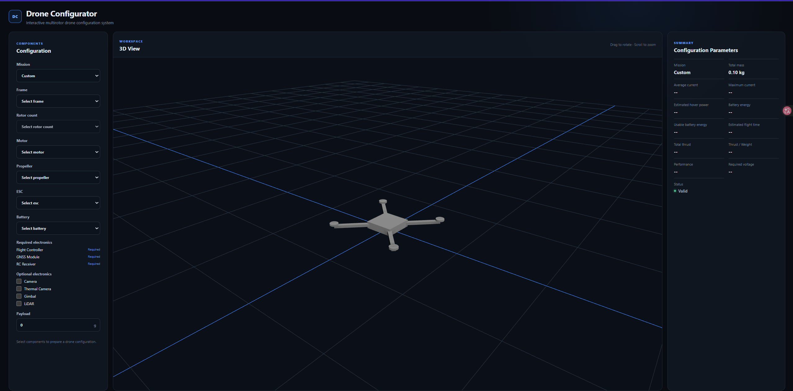

# Drone Configurator

A browser-based prototype for an interactive multirotor drone configuration system. The user selects a mission, frame, rotor count, propulsion components, battery, electronics, and payload; the app calculates performance, validates the build, recommends improvements, and renders a Three.js preview.



## Features

- Component catalog with frames, motors, propellers, ESCs, batteries, and electronics.
- Live calculations: total mass, thrust-to-weight ratio, currents, voltage range, hover power, battery energy, and estimated flight time.
- Validation with `Valid` / `Warning` / `Invalid` states and 11 diagnostic codes.
- Mission-specific recommendations for Agriculture, Delivery, and Professional use.
- Three.js viewer with GLB loading, caching, fallback models, and OrbitControls.
- Animated component installation for **Aster 450 + 4 rotors**:
  - frame arms and bolts;
  - central 4-in-1 ESC;
  - battery;
  - motors;
  - CW/CCW propellers and retaining caps;
  - complete assembly playback with pause, resume, restart, seek, and exit.
- Accessible custom select controls with keyboard navigation and typeahead.
- Responsive dark UI with three-column desktop layout.

## Tech Stack

- Vite 7
- TypeScript 5.9 (`strict`)
- Three.js 0.179 + GLTFLoader + OrbitControls
- Vanilla TypeScript and CSS (no UI framework)
- Node.js test runner + headless Chrome/Edge/Chromium

## Getting Started

```bash
npm install
npm run dev
```

Open the local URL printed by Vite.

### Build and Validation

```bash
npm run build      # tsc && vite build
npm run typecheck  # tsc --noEmit
```

### Tests

```bash
npm test           # 94 unit/integration tests
npm run test:ui    # 7 real-browser scenarios
```

The UI test looks for an installed Chrome, Edge, or Chromium. Set `CHROME_PATH` to override the executable. It starts a temporary Vite server and uses an isolated browser profile; no extra npm dependencies are required.

## Project Structure

```text
src/
├── configurator/   Domain types, calculations, validation, recommendations
├── data/           Component catalogs
├── models/         Legacy copies of generic GLB assets
├── three/          Three.js scene, model resolution, animations
├── ui/             Accessible custom select
├── main.ts         Application markup and UI state
└── style.css       Global styles and responsive layout

public/models/      GLB assets served at runtime
tests/              Unit, integration, GLB, and browser tests
```

## Documentation

For the complete technical reference, see [DOCUMENTATION.md](DOCUMENTATION.md). It covers:

- architecture and data flow;
- every dataset entry and unit;
- calculation formulas and validation thresholds;
- mission recommendation rules;
- UI element IDs and behavior;
- 3D model resolution, caching, mounting, and animation pipeline;
- asset inventory and node naming conventions;
- test coverage;
- known limitations and extension guide;
- Git branch layout.

## Units

Datasets use kg, V, A, Ah, W, kgf (motor thrust), inches, and Wh. The UI accepts payload in grams and stores it in kilograms.

## Important Notes

- Component data is synthetic/prototype data, not manufacturer-certified specifications.
- Calculations use a simplified hover-power model and are not suitable for real flight planning.
- Modular 3D components and full assembly playback are available only for Aster 450 with 4 rotors.
- Only a subset of catalog components currently has 3D assets.
- The project does not persist configurations between page reloads.

## Branch Layout

- `main` — complete integrated project.
- `chore/project-scaffold` — Vite/TypeScript scaffold.
- `feature/component-catalog` — types and datasets.
- `feature/calculations-validation` — calculations and validation.
- `feature/mission-recommendations` — mission advice and rotor compatibility.
- `feature/configurator-ui` — UI, styles, custom selects.
- `feature/3d-viewer` — Three.js scene and GLB assets.
- `feature/modular-assembly` — selection animations and full assembly.
- `test/automated-coverage` — automated tests.
- `docs/english-documentation` — README and technical documentation.

Feature branches are cumulative review milestones. Use `main` for development and builds.
